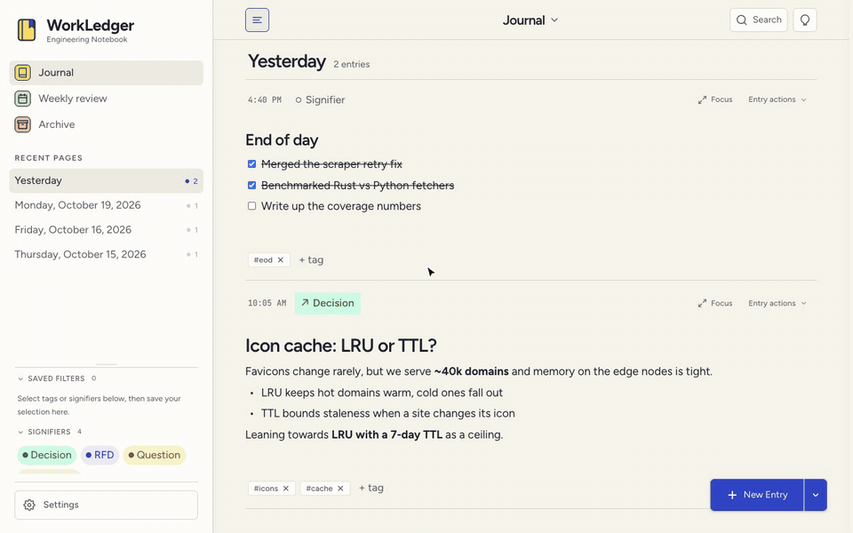

<p align="center">
  
</p>

<h1 align="center">WorkLedger</h1>

<p align="center">An open-source engineering notebook for documenting your daily work.<br>Built with React, BlockNote, and Excalidraw.</p>

<p align="center">
  <a href="https://github.com/gruberb/workledger/blob/main/LICENSE">
    
  </a>
  <a href="https://github.com/gruberb/workledger/actions">
    
  </a>
  <a href="https://github.com/gruberb/workledger/blob/main/CONTRIBUTING.md">
    
  </a>
  
  
  
</p>

<p align="center">
  
</p>

## Features

### Write

- **Daily entries**: organized by day with timestamps. New entry with `Cmd+J`
- **Rich text**: [BlockNote](https://blocknotejs.org/) editor with Markdown shortcuts and slash commands for headings, lists, checklists, tables and code blocks
- **Drawings**: embed [Excalidraw](https://excalidraw.com/) diagrams with `/drawing`
- **Code blocks**: syntax highlighting for 24 languages (Shiki), theme-aware
- **Dictation**: `/dictate` where the browser supports speech recognition (Chrome may send the audio to a web service)
- **Templates**: RFD (brief and full), Decision Log, Debugging Session, Meeting Notes, Learning Log and End of Day, with headings and tags filled in
- **Links and backlinks**: type `[[` to link entries; each entry lists the entries that link to it

### Organize and find

- **Signifiers**: mark entries as Decision, Question, Idea, Milestone, Small win or RFD. Most entries need none
- **Tags and saved filters**: filter by tags and signifiers, save the combination for one click. Active filters show in the header with Save and Clear all
- **Search**: full-text search across entries and tags (`Cmd+K`)
- **Pin and archive**: pin entries to the top; archive old ones and restore them anytime
- **Weekly review**: pick an ISO week to see its entries, signifier counts and top tags
- **RFDs**: write RFDs as entries, tag them by project, and filter by the RFD signifier plus the project tag to see a project's RFDs

### Make it yours

- **Themes**: Paper, Ink, Nord Aurora, Nord Polar Night, High Contrast Light and Dark
- **Fonts**: Figtree, Plus Jakarta Sans, DM Sans, Urbanist, Inter, JetBrains Mono or Source Serif 4
- **Resizable sidebars**: drag the inner edge; drag past the minimum to close
- **Focus mode**: one entry, full screen
- **Keyboard**: `Cmd+J` new entry, `Cmd+K` search, `Cmd+\` sidebar, `Cmd+Shift+I` AI sidebar, `Escape` clear filters

### Own your data

- **Local-first**: everything lives in IndexedDB in your browser. No account, no server
- **Optional sync**: end-to-end encrypted sync across devices with the default server or [your own](https://github.com/gruberb/workledger-sync). Entries are encrypted before they leave the browser ([details](docs/ENCRYPTION.md))
- **Import and export**: JSON backup and restore, Logseq graph import (see [Importing](#importing)), and single-entry downloads as PDF, Word or Markdown
- **Works offline and on mobile**: installable PWA with a mobile layout

## AI sidebar (optional)

Off by default and fully removable: delete `src/features/ai/` and nothing else changes.

- **Chat** with your notes: attach notes with the **Notes** button (recent notes or search), paste text, or drop screenshots
- **Prompts** as one-click chips: summaries of your day or week, standup updates, PR descriptions, ADRs and RFDs from notes, an RFD critique, rubber ducking, tradeoffs, and recall ("What did I decide about...?")
- **Your own prompts**: save instructions and choose what they run on (attached notes, today, this week, or your next message). Stored in this browser
- **Into your notes**: **Add to note** appends a reply to the attached note; **New entry** creates one
- **Threads**: every conversation is saved; reopen or delete it from the clock menu
- **Web research** with cited sources on Anthropic, OpenAI and OpenRouter, when enabled in AI settings (the provider bills each search)

**Set up:**

1. Open **Settings** in the left sidebar and choose **Enable AI**
2. Pick a provider:
   - **Ollama (local)**: install [Ollama](https://ollama.com/) and run `ollama pull mistral`. If WorkLedger runs on another origin, allow it with `OLLAMA_ORIGINS`
   - **Anthropic, OpenAI or OpenRouter**: paste an API key. Anthropic blocks browser requests for organizations with custom data retention; use OpenRouter there
   - **Hugging Face**: paste an [API token](https://huggingface.co/settings/tokens) and pick a model
   - **Custom server**: any OpenAI-compatible endpoint
3. Open the AI sidebar with the lightbulb in the header (`Cmd+Shift+I`)

Keys are stored unencrypted in this browser's IndexedDB, and requests go straight from the browser to the provider.

## Importing

Both imports are in the **gear menu** in the left sidebar. Importing never overwrites a newer version of an entry, so it is safe to run again.

### WorkLedger JSON

**Import entries** takes the file written by **Export entries**:

```json
{
  "version": 1,
  "exportedAt": "2026-10-11T12:00:00.000Z",
  "entryCount": 1,
  "entries": [
    {
      "id": "3f2b...",
      "dayKey": "2026-10-11",
      "createdAt": 1760184000000,
      "updatedAt": 1760184000000,
      "blocks": [],
      "isArchived": false,
      "tags": ["work"],
      "isPinned": false
    }
  ]
}
```

`blocks` is the [BlockNote](https://www.blocknotejs.org/) document. Entries that fail validation are counted as invalid and skipped.

### Logseq

**Import from Logseq** asks for your graph folder (the one containing `journals/` and `pages/`). Everything is converted in the browser; nothing is uploaded.

| Logseq | WorkLedger |
|--------|------------|
| Journal `journals/2024_06_15.md` | Entry on June 15, 2024 |
| Page `pages/Project X.md` | Entry on the file's last-modified day, titled "Project X" |
| Nested bullets | Nested list items |
| `TODO` / `DOING` / `LATER` / `NOW`, `DONE`, `CANCELED` | Checklist items (open, checked, checked and struck through) |
| `[[Page]]`, `[label]([[Page]])`, `{{embed [[Page]]}}` | Entry links (plain text if the page has no file) |
| `#tag`, `#[[multi word]]`, `tags::` | Entry tags |
| `title::`, `alias::` | Entry title, extra names for links |
| `((block-ref))`, `{{embed ((block-ref))}}` | The referenced block's text |
| Other `{{macros}}` (queries, renderers) | Shown as inline code |
| Other `key:: value` properties | Dropped |
| Local images from `assets/` | Not imported (a note marks where they were) |

Re-importing the same graph updates the entries it created earlier; entries you have edited in WorkLedger since then are kept. Journal file names must use Logseq's default `yyyy_MM_dd` format.

## Getting Started

```bash
git clone https://github.com/gruberb/workledger.git
cd workledger
npm install
npm run dev
```

Open [http://localhost:5173](http://localhost:5173) in your browser.

## License

MIT
